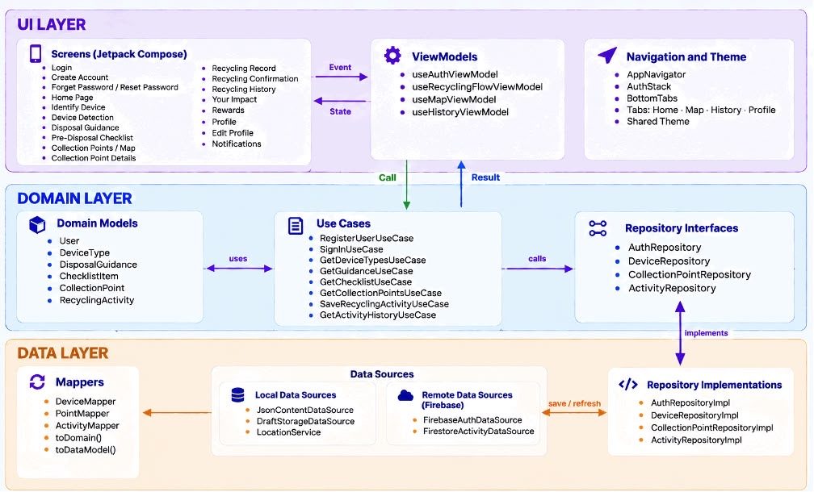

Loopit – System Architecture

1. Architecture Overview

Loopit is an e-waste recycling mobile application that helps users identify electronic devices, follow safe disposal instructions, locate recycling collection points, record recycling activities, and track rewards and environmental impact.

The application is designed using Clean Architecture with three main layers: UI, Domain, and Data. This structure separates user interface components, business logic, and data management to improve maintainability, testability, and scalability.

2. Architecture Layers

2.1 UI Layer

Responsibility: Manages user interactions, displays application screens, and observes UI state using Jetpack Compose and ViewModels.

Key Components:

* Jetpack Compose screens: Login, Home, Identify Device, Device Result, Disposal Guidance, Pre-Disposal Checklist, Collection Map, Recycling History, Rewards, Statistics, and Profile.
* ViewModels: AuthViewModel, RecyclingFlowViewModel, MapViewModel, and HistoryViewModel.
* Navigation: AppNavHost, NavigationBar, and shared Material Design theme.

Rule: The UI Layer must not directly access databases or implement data-storage logic.

2.2 Domain Layer

Responsibility: Contains the application’s business rules and coordinates operations between the UI and Data Layers.

Key Components:

* Models: User, DeviceType, DisposalGuidance, ChecklistItem, CollectionPoint, and RecyclingActivity.
* Use Cases: RegisterUserUseCase, SignInUseCase, GetDeviceTypesUseCase, GetGuidanceUseCase, GetChecklistUseCase, GetCollectionPointsUseCase, SaveRecyclingActivityUseCase, and GetActivityHistoryUseCase.
* Repository Interfaces: AuthRepository, DeviceRepository, CollectionPointRepository, and ActivityRepository.

Rule: The Domain Layer must remain independent of UI frameworks and specific database implementations.

2.3 Data Layer

Responsibility: Handles data retrieval, storage, authentication, and communication with local and remote data sources.

Key Components:

* Local Data Sources: JsonContentDataSource, DraftStorageDataSource, and LocationService.
* Remote Data Sources: FirebaseAuthDataSource and FirestoreActivityDataSource.
* Repository Implementations: AuthRepositoryImpl, DeviceRepositoryImpl, CollectionPointRepositoryImpl, and ActivityRepositoryImpl.
* Data Mappers: DeviceMapper, PointMapper, and ActivityMapper.

Rule: The Data Layer must not directly control UI navigation or presentation state.

3. Unidirectional Data Flow

Example Screen: Pre-Disposal Checklist

UiState: Loading, Success, Error, checklist items, and completion progress.

Events (UI → ViewModel):

* Load checklist for the selected device.
* Mark checklist items as completed or incomplete.
* Continue after completing the required tasks.

Explanation:

When the user opens the Pre-Disposal Checklist screen, the UI sends an event to RecyclingFlowViewModel. The ViewModel invokes GetChecklistUseCase, which requests the required checklist through DeviceRepository. DeviceRepositoryImpl retrieves the relevant data from JsonContentDataSource and returns it through the Domain Layer. RecyclingFlowViewModel updates the UI state, and Jetpack Compose recomposes the screen to display the checklist items and completion progress.

4. Feature Walk-through: Pre-Disposal Checklist

Step 1 – UI Layer

The user taps “Start Pre-Disposal Checklist” on DisposalGuidanceScreen, triggering an event handled by RecyclingFlowViewModel.

Step 2 – Domain Layer

RecyclingFlowViewModel invokes GetChecklistUseCase with the selected device identifier.

Step 3 – Domain Layer

GetChecklistUseCase processes the request and calls DeviceRepository to retrieve the preparation tasks.

Step 4 – Data Layer

DeviceRepositoryImpl retrieves the checklist from JsonContentDataSource and maps it into ChecklistItem domain models.

Step 5 – UI Layer

The retrieved data returns to RecyclingFlowViewModel, which updates the checklist UiState.

Step 6 – UI Layer

PreDisposalChecklistScreen observes the updated state and displays interactive checkboxes and completion progress.

5. Architecture Diagram

The following diagram illustrates the three-layer architecture and communication between the application components.

6. Architecture Benefits

* Separation of Concerns: Each layer has clearly defined responsibilities.
* Maintainability: Features can be modified independently.
* Testability: Business logic can be tested separately from the user interface.
* Scalability: Additional recycling services and data sources can be integrated.
* Consistent State Management: ViewModels and unidirectional data flow ensure predictable interface updates.
